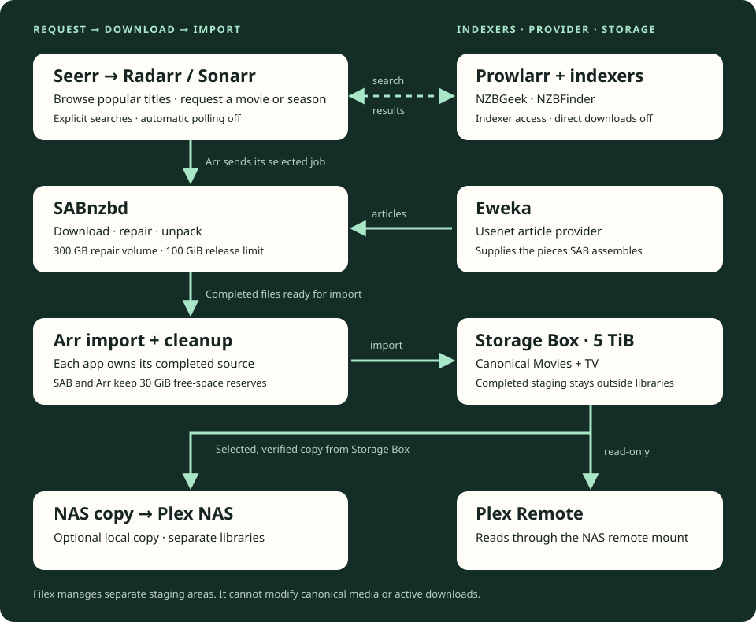

# Media and storage

This guide preserves the original Usenet explanations. Evidence is dated; the October 8 closure completed the accepted operational plan.

## Three jobs, three kinds of tool

Usenet sounds complicated because several small tools each own one step. The cleanest model is: *find a pointer, fetch the pieces, organize the result.*

### Discover in Seerr

Browse trending and popular movies and TV in Seerr, then request what you want. Radarr and Sonarr find releases through Prowlarr and the indexers.

Seerr · Radarr · Sonarr · Prowlarr

### The client fetches

SABnzbd reads the NZB, asks Eweka for the article pieces, checks them, repairs missing parts when possible, and unpacks the result.

Eweka · SABnzbd · PAR2

### Automation organizes

Radarr and Sonarr own each request, import its completed files, and remove their completed download sources. Plex discovers the library files.

Radarr · Sonarr · Plex

**The NZB is not the media.** It is closer to a shipping manifest: useful directions to many Usenet articles. Eweka supplies the articles; SAB assembles them.

## From a choice to two Plex libraries

The Storage Box is the canonical home. Cloud scratch is temporary. A NAS copy is optional and deliberately selected.

Start in Seerr for discovery and requests. Arr owns the request from search to cleanup. Prowlarr supplies indexer access; its direct downloading is disabled. Both remote playback and selected NAS copies read from the Storage Box.

## Shortcuts

See [Usenet pages and logins](access.md) for which account to use at each service, including Authelia MFA, AD-backed Jellyfin and the separate native Plex/Seerr logins.

Private addresses work on the home network or its existing VPN route. Browser entrances use the authentication described in the access guide; native clients retain their existing routes.

### Home stack

[**Seerr**Browse trending movies and TV · sign in with Plex](http://seerr.home.arpa/)
[**SABnzbd**Queue, speed, repair and unpack](https://sabnzbd.home.rytim.com/)
[**Prowlarr**Indexer connections and status](https://prowlarr.home.rytim.com/)
[**Radarr**Movies and their import history](https://radarr.home.rytim.com/radarr/)
[**Sonarr**TV series, episodes and calendar](https://sonarr.home.rytim.com/sonarr/)
[**NAS copies**Select local copies and follow transfers](https://catalog.home.rytim.com/)
[**Filex**Browse staging files · SSH tunnel required](http://127.0.0.1:15213/)
[**Plex**Choose a NAS or Remote library](http://plex.home.arpa/web/)
[**Jellyfin trial**Try the same general libraries](https://jellyfin.home.rytim.com/)

The [Jellyfin trial](../../../usenet-infra/docs/jellyfin-trial.md) runs alongside Plex on the NAS. Seerr still uses Plex for sign-in and availability; Jellyfin reads the same imported files and scans hourly.

### Provider and indexer accounts

[**NZBGeek My Cart**Cart auto-download off · use Seerr](https://nzbgeek.info/dashboard.php?mycart)
[**NZBFinder Cart**Cart auto-download off · use Seerr](https://nzbfinder.ws/cart)
[**My Eweka**Provider account](https://www.eweka.nl/en/myeweka)
[**Hetzner Console**Cloud and Storage Box account](https://console.hetzner.com/)

## Browse and request in Seerr

Choose a title

### Use Seerr

1. Open Seerr and sign in with your Plex account. Browse trending or popular movies and TV, filter by genre, or search for a title.
2. Choose Request for a movie, or select the TV seasons you want. The default prefers 4K (2160p), with 1080p fallback if no suitable 4K release is available. Use Radarr or Sonarr directly for release choices or individual episodes.
3. Seerr sends your request to Radarr or Sonarr, which searches the indexers and starts a matching download. Available items can be opened in Plex.
4. Follow download and repair in SAB, then import and cleanup in Arr's history. If an automatically selected release fails, Arr blocklists it and searches for another eligible release. Manually selected releases keep manual retry behavior. This does not put a time limit on repairs; failed payloads remain for review and can consume scratch space.
5. Watch in the corresponding **Remote** Plex library. Select a NAS copy separately if wanted.

Watchlist auto-download and automatic release polling are off. New future episodes are not automatically acquired; request them explicitly in Sonarr. Wait for a large download to finish before requesting another.

Choose a release

### Use interactive search in Arr

1. Open the movie or episode in its Arr application and run an interactive search.
2. Choose an accepted release within the 100 GiB download limit. Let the owning app send it to SAB.
3. Wait for import and completed-source cleanup before requesting the next large item.
4. If a release fails, inspect the reason. Failed records and payloads stay retained. Manually selected releases require a manual retry; automatically selected releases use Arr’s alternative-release search.
5. The three historical held requests were discarded on September 22; preserve their journals rather than replaying them.

Direct NZBGeek/NZBFinder cart intake, Prowlarr direct downloading, and the old cart workers are retired. New downloads use native Arr checks and cleanup.

Keep a local copy

### Use the NAS copy dashboard

1. Open NAS copies and select the canonical movie or TV title you want locally.
2. Start that title's copy action and follow the Downloads panel through copying, verification and completion. Closing the browser does not cancel the transfer.
3. Wait for Plex discovery, then choose the corresponding **NAS** library.
4. Use the dashboard's removal action to remove its owned local copy when finished. The canonical Storage Box source stays intact.

The NAS keeps a 100 GiB free-space reserve. Selected movie and TV copies, safe repeat and Plex discovery are verified. Copies do not automatically follow future episodes or upgrades.

Manage staging files

### Use Filex

1. Start `just usenet-filex-ui` from the smarthome folder on this computer and keep it running. Open Filex with the saved operator login. The SSH tunnel encrypts the connection; no certificate installation is needed.
2. Browse or download files. Copy or move between **Download staging** and **NAS staging**; copy from **Storage Box** into either staging area.
3. Wait for the transfer's verification and completed state. Transfers continue if the browser disconnects.
4. Moves and deletes retain staging sources in recoverable trash. Use Restore to undo; permanent purge is disabled.
5. If interrupted, inspect the failure and retry explicitly. Keep partial output until reviewed; retries do not overwrite it.

Filex cannot change canonical media or active downloads. Its NAS staging is separate from the Plex library; use the NAS copy dashboard when you want a managed local Plex copy.

**Verification depends on the workflow.** New downloads use SAB's checks and Arr's native import and cleanup. They no longer wait for a separate SHA-256 check before source removal. Selective NAS copies and Filex transfers still independently verify their destinations. Historical verification receipts remain preserved.

## Canonical, temporary, local, backed up

### Canonical library · Storage Box

The authoritative Movies and TV files live on the BX21 Storage Box, with 5 TiB total capacity. Cloud applications write through the controlled import path. The NAS and Filex receive read-only access.

### Temporary scratch · repair volume

A dedicated 300 GB volume holds downloads and repairs. Completed output is staged on the 5 TiB Storage Box before Arr imports it. SAB and both Arr applications retain 30 GiB free-space reserves and the 100 GiB release limit remains. The October 15 policy allows downloading during postprocessing and trials four-file parallel verification (`-T4`); direct unpack stays off. Apply this policy between processing jobs with `just usenet configure-post-processing`. It preserves manual pauses. Allow one large request to finish import and cleanup before the next: queued downloads, archive expansion and retained failures can still consume extra space. The reserve stops intake at low space but does not guarantee room for every repair.

The buffered-copy update targets SAB's completed-file transfer to the Storage
Box. Isolated tests measured about 93 MiB/s versus 41 MiB/s with the original
copy routine; this does not predict repair, unpack or total download time.
The rollout waits for processing to finish, retains the previous image for
rollback and checks the next real import. Storage safety limits remain unchanged.
See the [native media runbook](../../../usenet-infra/docs/native-media.md) for the
deployment and rollback controls.

### Local copy · NAS

An optional selected copy for local playback. Copying verifies the selected source and destination; it does not subscribe the NAS to future episodes or upgrades.

### Filex staging · cloud and NAS

These dedicated writable areas hold manual transfers and recoverable trash. They are separate from active downloads and the Plex libraries. The Storage Box view, including portal Scratch, is read-only.

### Backups · configuration and receipts

Encrypted scheduled archives cover configuration, databases, controller state and integrity receipts. Filex configuration, database and verification receipts now have encrypted recovery coverage; staging and media remain excluded. The archives do not duplicate the whole media library or establish whole-NAS disaster recovery. The native state passed an independent restore on September 22. Seerr configuration and its database are included in new cloud archives.

The encrypted settings schedule also captures native QTS settings and HBS backup
configuration as of October 17. Its first archive passed off-host readback,
decryption, payload checksums and database integrity checks. Replacement-NAS boot
and HBS credential recovery on another device remain untested.

The separate Backblaze B2 job was corrected on October 17 to include selected
private originals, two Public folders, both Time Machine shares and the encrypted
settings archives, while excluding replaceable media and caches. The expanded
selection was narrowed on October 19 to keep only `SpaceBlackTimeMachine` for
the current laptop; the retired SpaceGray share was removed from future backups
and its local share/data deletion verified. Existing B2 versions were not manually
purged. The expanded
upload completed on October 18; the October 19 run succeeded and its quick
integrity check reported Good. B2 restore verification remains pending. On
October 19, the upload rate was capped at 10 MB/s, always on, all seven days,
to reduce contention with Plex. Playback during a capped backup remains untested.
See [NAS backup coverage and verification limits](../../../usenet-infra/docs/scheduled-backups.md).

The approved September 20 expansion retained the CX43 server and added $32.01/month at the confirmed account rates: $9 for the Storage Box upgrade and $23.01 for the repair volume. These are dated rates, not a live invoice. The original incomplete spool remains retained for recovery.

**Storage Box snapshots are not independent backups.** They share the same storage system and consume its capacity. Treat the canonical library and configuration backup scopes separately.

## What is deployed—and what is still open

Deployed / observed

- Seerr discovery and a verified 2160p request/import with Plex availability; private cloud search and download applications
- Canonical Storage Box movie and TV library paths
- Native movie and episode import, source cleanup and Plex discovery
- 80 GiB synthetic PAR2 reconstruction and two concurrent 50 GiB expansion streams verified; about 91 GiB remained free at the latter peak
- SAB/Arr restart, storage-mount protections and retired-worker startup guards
- Filex transfers, recoverable moves/deletes, restore and interruption/retry
- Verified selective NAS movie and TV copying, safe repeat and Plex discovery
- Separate Plex NAS and Remote libraries
- Apple TV and Roku playback and restricted privacy confirmed by the user
- Scheduled encrypted configuration backups, including verified off-host NAS/Plex settings
- Seerr and Filex browser sign-in and browsing confirmed by the user
- Isolated replacement-server startup, reboot and storage-loss guards; temporary resources removed

Scope limits

- Repository-owned archives cover settings only. B2 has a separately selected originals/Mac-backup scope; expanded uploads succeeded, but restore verification remains pending. Whole-NAS recovery is not established.
- The replacement drill used empty read-only library fixtures; live provider, NAS and VPN integration were excluded
- Archive expansion beyond the measured limits; current queue and reserve controls remain in place

September 20 acceptance: Plex discovered the new movie automatically. The episode was matched to its exact imported file after a scan of the general remote TV library. Indexing does not prove device playback. The three old paused requests were discarded on September 22 at the user’s request; their historical journals and hold evidence remain preserved.

**September 22 health check passed.** The user-authorized disposal resolved fourteen historical failure records while retaining their audit history. Application health is clear. This dated result is not a live health monitor.

This page is deliberately static. It does not query applications, list media, or turn a documented observation into a live status claim.

## Start with the owner of the stuck step

| Symptom | Look first | Safe response |
| --- | --- | --- |
| Scratch is full or SAB reports “no space” | SAB queue/history, the owning Arr application, cloud health and filesystem usage | Keep acquisition held. Do not delete failures, clear history, resume a large job or restart SAB until exact jobs and durable state are reconciled. |
| A job is paused | SAB’s per-job pause and current capacity notes | Assume it may be a manual or protective pause. Do not release it just to make the queue move. |
| SAB, Prowlarr, Radarr or Sonarr is unavailable | Private route first, then discovery/cloud health | Separate network reachability from an application failure. Recheck after scratch recovery; do not assume every HTTP error has one cause. |
| Download finished but import is delayed | The owning Arr queue/history; retained journals for historical cart jobs | Preserve the completion and journal. Never replay an import or reset activation blindly. |
| Imported item is not visible in Plex | Correct library, readable episode filename and Plex scan timing | Check the file exists in the expected library. A manually matched episode may still have a scrambled name: use Sonarr's verified file assignments and scoped rename preview before scanning its folder. See the [availability repair procedure](../../../usenet-infra/docs/seerr.md). Keep private libraries excluded and automatic trash emptying off. |
| A release fails with missing articles | The failure in SAB and the owning Arr history | Arr removes handled failed payloads and retains failure/blocklist evidence; SAB archives the history. Apply with `just usenet configure-failed-cleanup`. Unowned jobs still need review. Arr searches for an alternative after an automatically selected release fails; manually selected releases retain manual retry behavior. Reconcile the existing request before another manual grab. |
| Filex transfer interrupted | Filex operation history and destination space | Keep the source and partial destination. Review the error before an explicit retry; use Restore for sources retained in staging trash. |
| NAS copy failed | NAS Downloads panel, free-space reserve, source availability and exact failure text | Retry only the same owned item after the blocking condition is fixed. Do not overwrite an unrelated destination or grant the NAS write access upstream. |

## Check without changing the system

Run these from the repository root. They inspect current state and should be the first stop before a restart, retry or deployment.

`just usenet-discovery-health`
`just usenet-cloud-health`
`just usenet-qnap-health`
`just usenet native-ownership-status`
`just usenet-native-cutover-preflight`
`just usenet filex-status`
`just native-status`

The native preflight reads current ownership, preserved holds and mounted free space. It does not change the system. A read-only capture can report that the earlier cutover is accepted and active.

**Privacy note:** `native-status` can print real media names. Keep its output in private ignored evidence; do not paste it into commits, tickets or chat.

## Terms you will actually see

Provider
:   A paid service, here Eweka, that serves Usenet articles to the download client.

Indexer
:   A searchable catalogue that turns a desired post into an NZB pointer file.

NZB
:   A small XML instruction file listing the Usenet article pieces needed for a job; it is not the downloaded payload.

Retention
:   How far back a provider keeps articles. Older availability can improve the odds of finding every piece.

Completion
:   Whether the provider has enough of the required article pieces to reconstruct the post.

PAR2 repair
:   Recovery data that can rebuild some missing or damaged pieces. Repair consumes temporary disk space.

Unpacking
:   Extracting the finished files from archives after verification or repair. Peak space may include both archives and extracted output.

RSS
:   A periodic release check. Direct cart intake is disabled. Native polling also stays off to preserve the existing backlog; use explicit searches in Arr for new requests.

Quality profile
:   Radarr or Sonarr rules describing acceptable resolution, source, upgrades and cutoffs.

Arr
:   Shorthand for Radarr (movies) and Sonarr (TV). Each owns its requests, SAB category, import and completed-source cleanup.

Staging
:   A temporary working area. Acquisition staging belongs to SAB and Arr; Filex has separate staging for manual transfers.

Canonical
:   The authoritative copy. In this system that is the Storage Box library, not cloud scratch or an optional NAS copy.

## Recovery alerts

Sonarr and Radarr give future imports readable names using their existing
formats. Recyclarr maintains those settings and keeps automatic upgrades off.
Existing filenames and quality choices are preserved. Future movie and TV
selections reject releases labelled AV1, which can force slow conversion on older
TV players. H.264 and HEVC remain eligible. This checks release names, so playback
still depends on the actual video, audio and subtitle formats. Existing copies
are replaced only when explicitly requested. Ambiguous imports remain report-only.

A five-minute report-only check follows approved Seerr requests through native
media processing. It checks for existing files first, holds active downloads,
and proposes matching completed files before looking for missing episodes.
Ambiguous files and extras-only packs need review. It does not start recovery
downloads or change files. A separate, bounded worker now handles approved
missing TV episodes as described below.

Home Assistant shows one persistent notification when something needs attention
and clears it when resolved. It also warns if the cloud monitor stops checking
in for 20 minutes. Imported files waiting more than 15 minutes for Seerr to show
availability are reported separately; that status does not prove playback. A Plex
sync that has stopped for 20 minutes also raises an alert. The private connection
check verifies that Seerr can reach the expected Plex server through the VPN.
For repaired files, refresh the affected Plex folders and sync Seerr instead of
requesting the episodes again.

Use `just usenet seerr-recovery-status` for a private summary. The
[native media runbook](../../../usenet-infra/docs/native-media.md#seerr-recovery-reporting)
explains matching rules, reports, deployment and how to pause monitoring.

Recyclarr maintains settings daily. Approved Seerr requests are tagged, and
movies outside approved requests are unmonitored. Cleanuparr is being qualified
only in an offline dry-run lab, with saved repair cases and no media access.
Ambiguous episode matches still need review. It is not enabled against the live
library. See the [rollout and qualification details](../../../usenet-infra/docs/native-media.md#settings-ownership-and-offline-recovery-qualification).

### Missing requested episodes

The approved TV recovery worker checks once per minute and grabs at most one
Sonarr-approved release mapped to exactly one missing requested episode. It
rechecks library records and active downloads first, keeps at most three jobs
queued, and holds on pauses, processing, health or storage issues. Existing files,
season packs and ambiguous imports are excluded. Retry budgets persist across
restarts; exhausted or uncertain attempts need review. Sonarr performs the import
and cleanup. Use `just usenet seerr-recovery-execute-status` to inspect it.

Date-named daily programmes need the correct native series type; a numbered-series
setting can reject otherwise valid releases before any download begins.

## Official references

[**SABnzbd guide**Setup and core client concepts ↗](https://sabnzbd.org/wiki/introduction/quick-setup)
[**Servarr wiki**Radarr, Sonarr and Prowlarr documentation ↗](https://wiki.servarr.com/)
[**Plex support**Libraries, discovery and playback ↗](https://support.plex.tv/articles/)
[**Storage Box docs**Access, snapshots and capacity ↗](https://docs.hetzner.com/storage/storage-box/)
